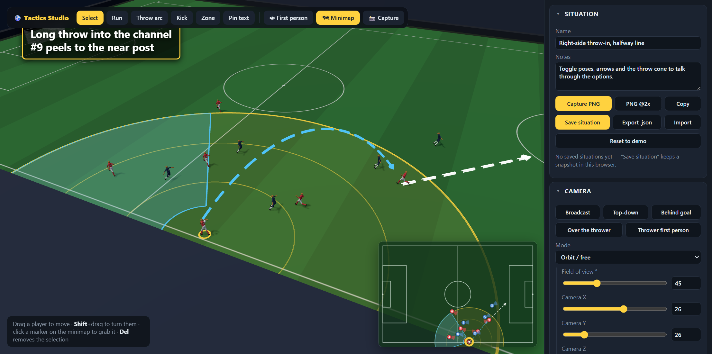

# ⚽ Soccer Tactics Studio

A browser-based 3D soccer situation simulator built for **talking about tactics** — pose the players,
stand behind the thrower's eyes, draw the options, and capture the frame.

Everything is a single scenario object: pose it, annotate it, save it as JSON, export it as a PNG.



## What it does

**First-person from the thrower**
Put the camera behind the eyes of whoever is taking the throw. Drag to look around (which turns the
thrower with you), or unlink the yaw and look independently. Eye height, forward/lateral offset and
field of view are all adjustable, and their own body can be shown or hidden.

**Toggle-on minimap overlay**
A top-down tactics board over the 3D view. Any corner, any size, four rotations, adjustable opacity —
it draws shirt numbers, facing wedges, team colours, the ball, every arrow and the throw range, plus a
live cone showing where the 3D camera is pointing. **Drag markers on the map to move players**; the 3D
view follows. Press `M` to toggle it.

**Players**
Position, facing, pose, opacity, height, shirt number and name. Eighteen poses — throw wind-up, loaded,
release and follow-through, running, sprinting, jumping, heading, defending, keeper set, slide tackle
and more — each mirrorable. Team kits (jersey / shorts / socks / skin / number) plus a per-player kit
override for keepers and bibs, and separate minimap marker colours.

**Arrows, in both views at once**
Arrows live in pitch coordinates, so every one is drawn in the 3D world *and* on the minimap:

| Type | For |
| --- | --- |
| Run / pathway | a player's movement, multi-point and curved |
| Throw arc | a real 3D parabola with adjustable release height, apex and landing height |
| Kick direction | a straight arrow off the ball |
| Zone | a filled area to mark space |

Every arrow customises colour, width (in metres), opacity, dashed/dotted with dash and gap lengths,
arrow heads (end / both / none) with head size, ground clearance, and a sideways bend.

**Throw range**
A max-distance circle from the thrower with optional distance rings, and a target cone/sector with
adjustable half-angle, reach and inner cutoff that can follow the thrower's facing. Turn on the 3D
volume to show the throw envelope from the release point out to the ground sector.

**Camera**
Orbit, pan and zoom, or type exact position/target/field-of-view numbers. Presets for broadcast,
top-down, behind the goal, over the thrower, and thrower first-person.

**Text overlays**
Screen-fixed captions or labels pinned to a spot on the pitch (with a leader line down to the grass).
Font, size, weight, colour, alignment, line height, letter spacing, opacity, background colour +
alpha + padding + corner radius, border colour and width, and shadow colour/blur/offset. Drag them
anywhere.

**Situational capture**
`Capture PNG` composites the 3D view, the minimap and every text overlay into one image (1x or 2x, or
straight to the clipboard). `Save situation` snapshots the whole scenario into this browser with a
thumbnail; `Export .json` gives you a file to share or version.

## Example situations

`situations/` holds saved scenarios. Load one with **Import** in the Situation panel:

| File | What it shows |
| --- | --- |
| [`throw-into-empty-area.stsx.json`](situations/throw-into-empty-area.stsx.json) | Don't throw at the player — throw into the channel between them and the sideline. Narrow 7° cone at 16 m, two throw arcs, sideline camera. |

## Run it

```bash
npm install
npm run dev
```

Then open the printed URL. `npm run build` produces a static `dist/` you can host anywhere.

## Controls

| | |
| --- | --- |
| Drag a player | move them |
| `Shift` + drag | turn them to face the pointer |
| Drag on the minimap | move a player from above |
| `1`–`6` | select tool (select, run, throw arc, kick, zone, pin text) |
| Click, then `Enter` / double-click | add arrow points, then finish |
| `Esc` | cancel drawing / clear selection |
| `Del` | delete the selection |
| `M` | toggle the minimap |
| `F` | toggle first person |
| `Ctrl`+`E` | capture a PNG |
| `Ctrl`+`S` | save the situation |

## Scripting hook

The live app is exposed on `window.STS` for automation and embedding:

```js
STS.store.state.players[0].pose = 'throw_release';
STS.touch('ui');            // re-render
const png = STS.capture(2); // data URL of the composited frame
STS.load(scenarioJson);     // replace the whole situation
```

## How it is put together

| File | Role |
| --- | --- |
| `src/types.ts` | the scenario model — everything drawn is derived from it |
| `src/state.ts` | the store, defaults and the demo throw-in |
| `src/pitch.ts` | pitch markings painted to a canvas texture, goals, stands |
| `src/player.ts` | the articulated player rig and the pose library |
| `src/annotations.ts` | arrow sampling, dashes, tubes and heads (shared with the minimap) |
| `src/range.ts` | throw circle, sector and 3D volume |
| `src/camera.ts` | orbit + first-person rig and camera presets |
| `src/minimap.ts` | the 2D top-down overlay and its coordinate transforms |
| `src/overlays.ts` | DOM text overlays and leader lines |
| `src/capture.ts` | PNG compositing, scenario files, saved situations |
| `src/panel.ts` | the control panel |
| `src/main.ts` | scene sync, pointer/keyboard interaction, render loop |

Pitch coordinates are metres on a 105 × 68 field: `x` runs along the length (±52.5), `z` across the
width (±34), `y` is up. Headings are degrees, `0` = facing `+x`.

Built with [three.js](https://threejs.org), TypeScript and Vite. No backend — everything runs locally
in the browser.

## Licence

MIT
